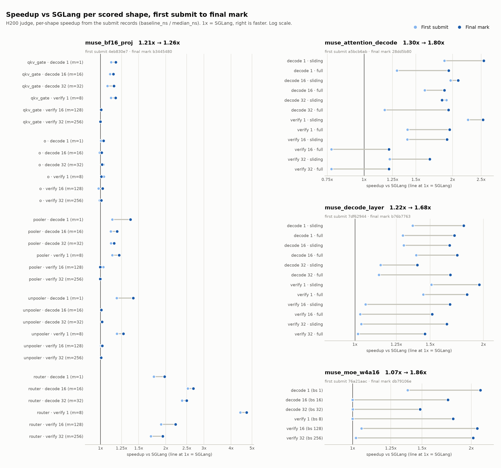
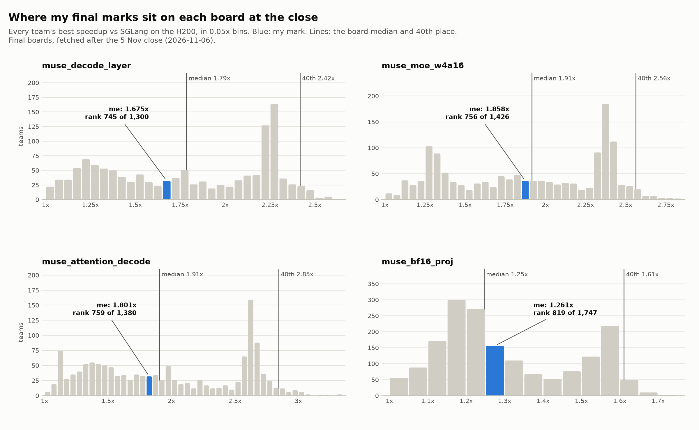
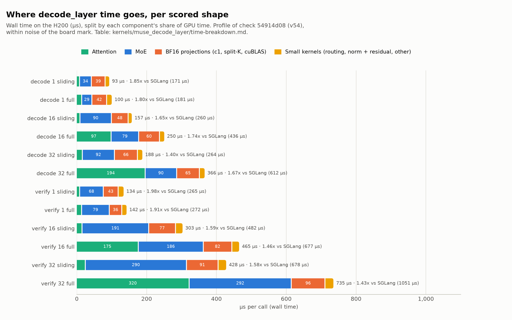
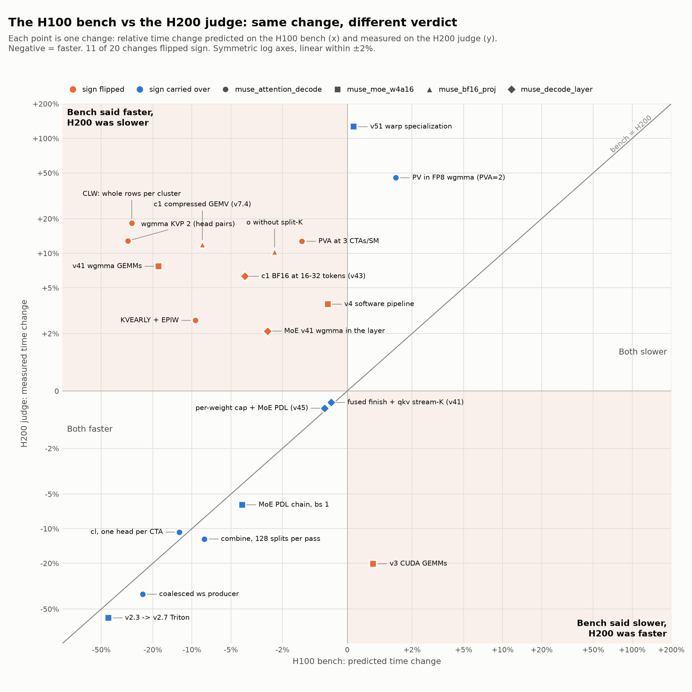

# Muse Spark kernels: Open Kernel Challenge 2026

This repo holds the kernels and measurements from my entry (`nicorosaless`) in the
[Open Kernel Challenge](https://openkernelchallenge.dev) (Muse Spark track, 24 Oct to 5 Nov 2026).
The task was to beat SGLang on four ops of one Muse Spark decoder layer, timed on an H200. Each
kernel comes with a guide that explains it line by line, and every number in the docs points to the
judge's own JSON in `evidence/`.

## Results

Each speedup is against SGLang's kernels on the judge's H200, and each comes from the judge's own
JSON in `evidence/runs/`. Ranks are from the final boards, fetched after the 5 Nov close
(`evidence/boards/2026-11-06-*`).

| problem | what it is | final speedup | final rank |
|---|---|---|---|
| [`muse_decode_layer`](kernels/muse_decode_layer/) | the whole decoder layer; the overall board follows this one | **1.675x** | 745 / 1300 |
| [`muse_moe_w4a16`](kernels/muse_moe_w4a16/) | routed experts, NVFP4 weights, BF16 activations | **1.859x** | 756 / 1426 |
| [`muse_attention_decode`](kernels/muse_attention_decode/) | paged FP8 KV-cache attention, decode and 8-token verify | **1.801x** | 759 / 1380 |
| [`muse_bf16_proj`](kernels/muse_bf16_proj/) | dense BF16 projections with 1-256 tokens | **1.261x** | 819 / 1747 |
| overall | | | 748 / 2014 |

This is a mid-table result, and the next chart shows where it sits. On three of the four boards
my mark is just below the median; on bf16 it is just above. My last improving submit was on
30 Oct. The ranks kept falling until the close because about 140 more teams entered, not because
the kernels changed ([`charts/rank_by_day.png`](charts/rank_by_day.png)).

## What is in each kernel

- **MoE (NVFP4).** Two CUDA GEMMs with no shared memory and no barriers. Each warp streams
  16-byte weight loads, decodes E2M1 codes into BF16 subnormals with bit tricks and runs
  `mma.sync` with the weights on the M side. Reordering the bits inside each 32-bit word in
  `prepare()` cut the decode from 15 to 11 operations per word, and that change alone gave +17%.
  A later multiply trick took it to 10. A per-warp dynamic work queue (`atomicAdd` plus
  `__shfl_sync`) gave the last +2.6%.
- **Attention.** The whole step is fused: QK-norm, RoPE, FP8 cache write, attention and the
  output gate, plus a small combine kernel. Split-KV is sized to fill exactly one wave of CTAs.
  The layer type picks one of three attention kernels:
  - a Triton kernel for the sliding layers;
  - a CUDA decode kernel with an explicit `cp.async` pipeline;
  - `verify_ws`, a small FA3-style kernel with producer and consumer warpgroups, mbarriers and
    `setmaxnreg`.
- **BF16 projections.** A split-K GEMV whose reduction kernel is chained with programmatic
  dependent launch (PDL). Weights are compressed losslessly from 16 to 12 KB per 64×128 block
  and decoded in registers, which is the only way to go below the bandwidth floor.
- **Decode layer.** It composes the three kernels above with SGLang's ops where mine didn't win.
  It adds its own routing and FFN-boundary kernels, a side stream for the router and PDL chains
  across the small-batch MoE.

## Five lessons, with numbers

1. **An H100 bench often predicted the wrong sign on the H200 judge.** Of 20 changes I could
   pair, 11 flipped sign. Most of them traded bytes for ALU work, switched the MMA path or changed
   CTAs per SM. Examples:
   - wgmma in the MoE GEMMs: −18% on the bench, slower on the H200;
   - compressed weights at 32 tokens in the layer: −12 to −15 µs on the bench, +12 to +31 µs on
     the H200;
   - cluster-shared KV rows in attention: −30% on the bench, +18% on the H200.

   Changes that only removed latency or bytes carried over.
   
2. **The noise is ±1.5-3% on the judge.** A submission needed a check above the current mark's
   95% CI, and in the last week two such checks. Several +1% candidates stayed inside the noise
   and were never submitted.
3. **With few tokens, everything is bandwidth or instruction issue.** Moving fewer bytes
   (lossless compression) and issuing fewer instructions per weight (the bit layout) beat every
   cleverer pipeline.
4. **Warp specialization isn't free.** In the MoE, producer/consumer warpgroups with wgmma ran 2x
   slower than the plain kernel, because only 8 warps per SM were left decoding instead of 16.
   The tensor core was never the bottleneck.
5. **A win on one op can vanish in the full layer.** The MoE work queue gave +2.6% on the MoE
   board and nothing inside the layer, where routing already spreads experts evenly.

[`docs/lessons.md`](docs/lessons.md) has the long version and links each lesson to its evidence.

## Conclusion

The kernels beat SGLang on every board, by 1.26x to 1.86x, and each of the 12 scored shapes of the layer
runs faster than SGLang's (1.40x to 1.96x). That was not enough to stand out: the median team on the
layer board reached 1.79x, and 40th place was at 2.42x, 44% ahead of me. The gap to 40th was 38%
on MoE, 58% on attention and 28% on bf16.

The gains that held came from two kinds of change. One read fewer bytes: compressed BF16 weights
and NVFP4 decoded in registers. The other issued fewer instructions per weight: the bit layout of
the MoE decode and a GEMM loop with no shared memory. A third group only removed latency: PDL
chains, the fused attention step and one-wave split-KV. Everything that traded bytes for compute
or changed the MMA path either lost on the H200 or was too close to call.

Three things cost the most:
- **Trusting the H100 bench for too long.** The first sign flips showed up on 27 Oct. Before that,
  I took bench gains at face value and built two layer versions on them (wgmma in the MoE,
  compressed weights at 16-32 tokens), and both lost on the H200 (checks `2e7740f3` and
  `798dd690`).
- **Stopping early.** The last experiment ran on 30 Oct, five days before the close. The boards
  kept moving in those days and my marks did not.
- **Too little time on the biggest shapes.** On the layer, MoE verify 32 (~290 µs, 2.7 times its
  bandwidth floor) and attention verify 16/32 full (175 and 320 µs) are most of the remaining
  time. [`time-breakdown.md`](kernels/muse_decode_layer/time-breakdown.md) works out that no single
  piece closes the gap. Even MoE at 1.5 times its bandwidth floor, attention at 2 times, the
  projections at 1.3 times and the small kernels at 4 µs, all at once, give 2.23x: still short of
  the 2.25x that 40th place needed on 30 Oct.

What carries over to other inference work is the method more than any one kernel. Measure on the
target GPU before stacking changes. Know whether a kernel is limited by bytes, instructions or
latency before optimizing it. Treat ±2% as noise until two runs say otherwise. Keep every claim
tied to a file, a hash and the judge's JSON.

## How to read this repo

| path | what |
|---|---|
| `kernels/<problem>/README.md` | **start here**: what changed in each version and the reading order |
| `kernels/<problem>/kernel.py` | **the code to read**: the final kernel with dead experiment paths removed and the docstrings rewritten as a guide |
| `kernels/<problem>/submission.py` | the exact file behind the final leaderboard entry (sha256 in `evidence/provenance.json`) |
| `kernels/<problem>/MAP.md` | every function, Triton kernel and CUDA kernel in `kernel.py`, with links to its lines |
| `kernels/<problem>/cuda/*.cu` | the CUDA kernels, copied out of `kernel.py` for syntax highlighting (see below) |
| `kernels/<problem>/concepts.md` | the concepts behind the kernel, with ASCII diagrams |
| `kernels/<problem>/what-didnt-win.md` | what didn't win on the H200, with numbers |
| `kernels/<problem>/versions/` | earlier submissions, one per design step |
| `kernels/<problem>/experiments/`, `tools/` | variants that lost, and the offline tools (SASS without a GPU, bit-layout searches, emulators) |
| [`docs/method.md`](docs/method.md) | how the work was organized: bench, calibration, quota and submit rules |
| [`docs/lessons.md`](docs/lessons.md) | the lessons in detail |
| [`docs/timeline.md`](docs/timeline.md) | day by day, with ranks |
| `evidence/` | the judge's JSON for every check and submission, bench results, board snapshots, H100 hours |
| `charts/` | charts, generated by `scripts/charts.py` from `evidence/` |
| `scripts/bench/` | the H100 bench that imitates the judge (Slurm and Singularity) |

**`kernel.py` and `submission.py`.** Each submission grew for a week through dozens of experiments,
and most of their switches ended up off. `kernel.py` keeps only what runs: the same kernels, the
same tuning and the same launch sequence, with dead branches, unused helpers and history comments
removed. The cleanup came after the judge closed, so `kernel.py` itself never ran on the H200.
Its equivalence was checked offline instead:
- the same host-side decisions (kernel, grid, constants, splits, PDL) for every shape in each
  dispatch range;
- identical sm_90a PTX for every CUDA kernel and configuration it compiles;
- identical Triton kernels (same syntax tree or same sm_90 PTX);
- correctness tests against the reference, run locally on an RTX 2080 or in Triton's CPU
  interpreter, whose outputs match `submission.py`'s bit for bit. bf16 matches to FP32 rounding,
  because its atomics add in a different order each run.

Each kernel's README gives the numbers. `submission.py` stays untouched as the scored file.

**Hashes and branches.** The docs cite commits and branches (`feature/P-2610-okc-*`) from the
private working repo. This repo is a clean export of it. `evidence/provenance.json` maps each
file back to its source commit. The bench ran on a university H100 cluster; paths and host names
that only made sense on my machines appear as `‹tmp›`, `‹local›`, `‹scratch›` or `‹node›`.

**Why the CUDA lives in Python strings.** The challenge takes one Python file per problem and
requires every GPU kernel to be built from readable source during the run. So the CUDA kernels
are raw strings compiled in-process with NVRTC. `scripts/kernel_map.py` copies each one to
`kernels/<problem>/cuda/` (with the MoE template already filled in) so GitHub can highlight it.

**Running the kernels.** `kernel.py` and `submission.py` both follow the challenge interface
(`prepare`, `kernel_fn`) and need the challenge's harness and SGLang's image (`okc init <problem>`).
The harness files are not redistributed here.

## License

Apache License 2.0 (`LICENSE`). The challenge's terms already license every submitted kernel
under Apache 2.0, the license of SGLang, so the whole repo uses it. The kernels import SGLang at
runtime but don't include its source. The challenge's problem files (`TASK.md`, `reference.py`,
the harness) belong to its organizers and are not included.
